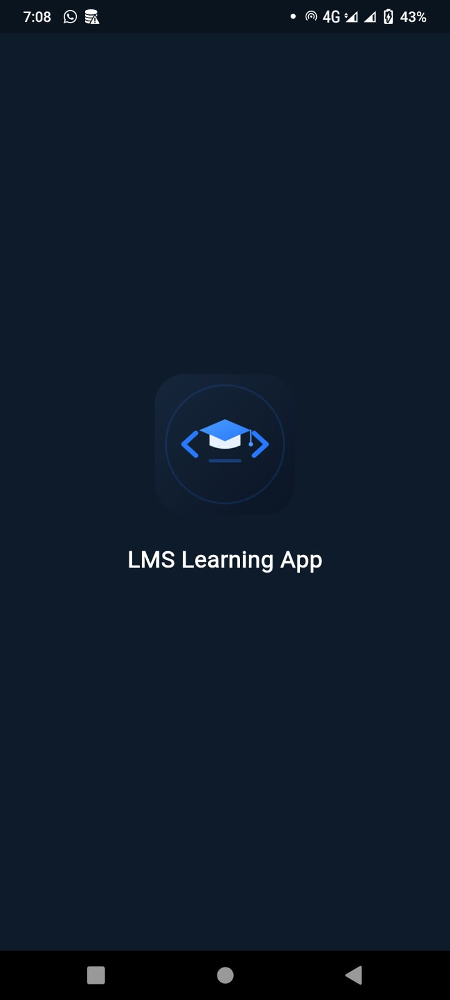
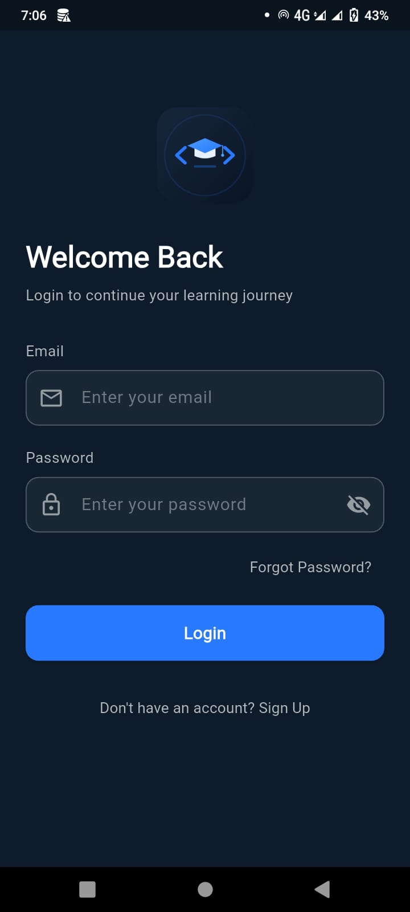
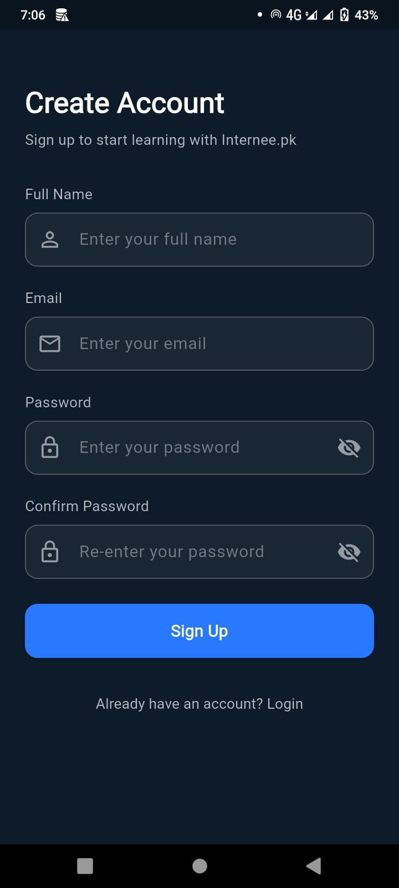
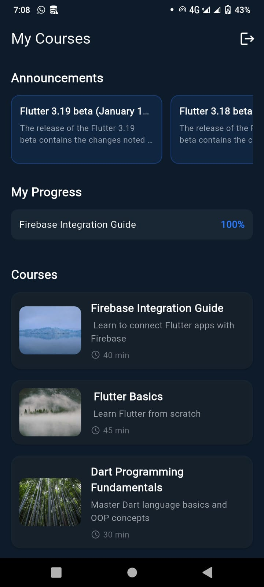
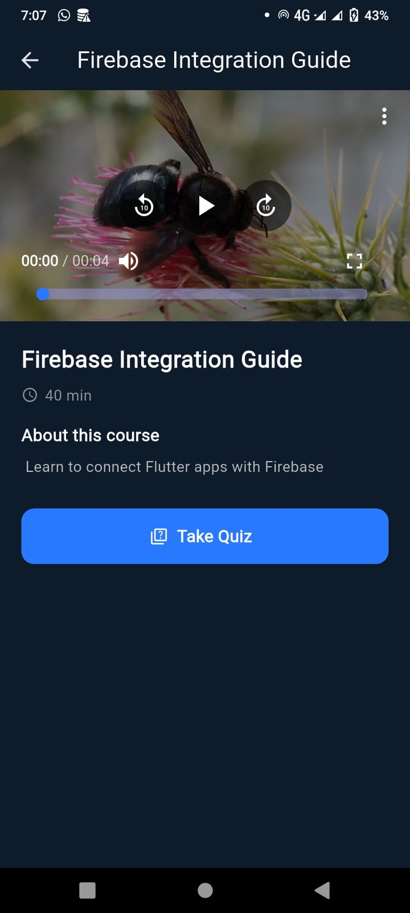
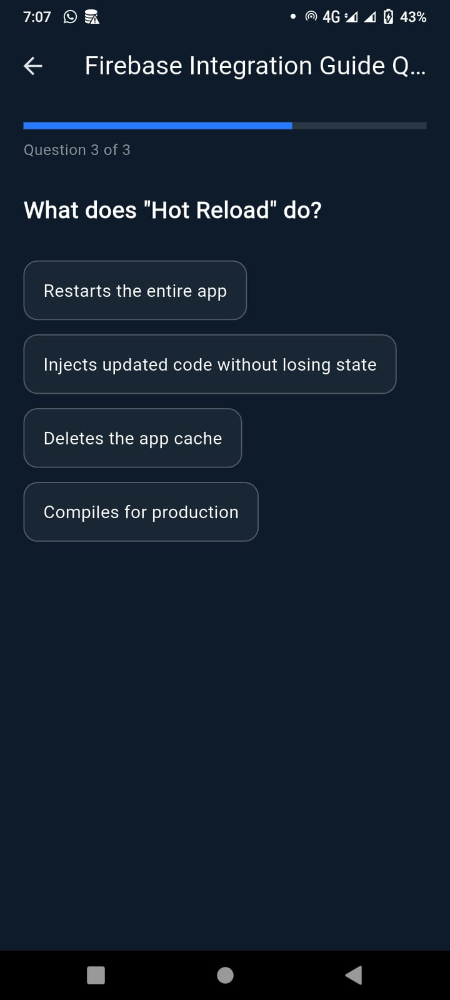
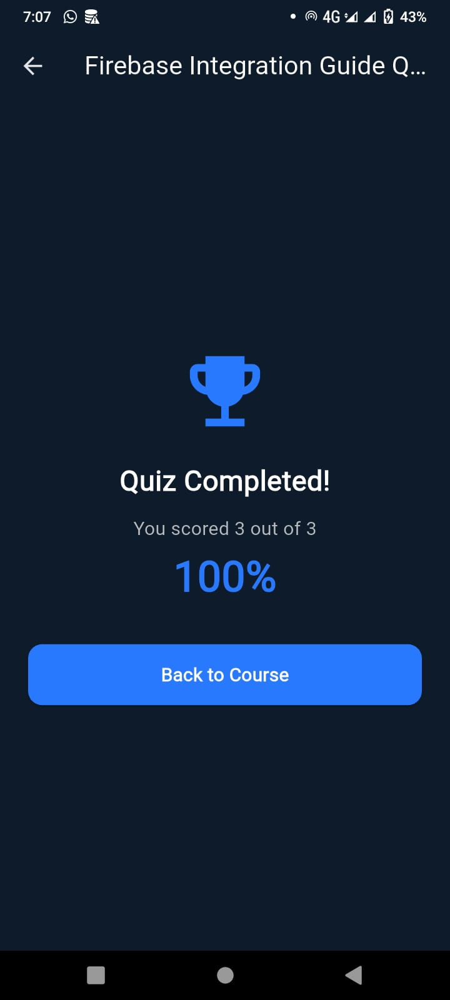

# 📚 LMS Learning App

A fully functional Learning Management System (LMS) mobile application built for **Internee.pk Virtual Internship — Task 1**. The app provides students with seamless access to course content, integrated video lectures, and interactive quizzes with real-time scoring and progress tracking.


---

## ✨ Features

- 🔐 **Firebase Authentication** — Secure Email/Password Signup & Login, with Forgot Password flow
- 📖 **Course Listings** — Real-time course data fetched from Cloud Firestore
- 🎥 **Integrated Video Player** — Stream lecture videos directly in-app using `video_player` + `chewie`
- 📝 **Interactive Quizzes** — Real-time scoring with instant visual feedback (correct/incorrect)
- 📊 **Progress Tracking** — Quiz scores saved per-user in Firestore, displayed on the Home screen
- 🌐 **REST API Integration** — Live announcements fetched from an external REST API (GitHub Releases API)
- 🎨 **Custom Branding** — Dedicated app icon, native splash screen, and in-app animated splash
- 🏗️ **Clean Architecture** — Feature-based folder structure with clear separation of data, providers, and UI layers

---

## 🛠️ Tech Stack

| Layer | Technology |
|---|---|
| Framework | Flutter (Dart) |
| State Management | Riverpod |
| Authentication & Database | Firebase Auth + Cloud Firestore |
| Video Playback | `video_player`, `chewie` |
| Networking | `http` (REST API integration) |
| Architecture | Clean Architecture (feature-based) |

---

## 📱 Screenshots

> Screenshots go in a `/screenshots` folder in the project root. Take these on your device/emulator, save them with the filenames below, then they'll display automatically here.

| Splash Screen | Login | Sign Up |
|---|---|---|
|  |  |  |

| Home Screen | Video Lecture | Quiz |
|---|---|---|
|  |  |  |

| Quiz Result |
|---|
|  |

---

## 🏗️ Project Structure

```
lib/
├── core/
│   ├── constants/
│   ├── theme/
│   └── utils/
├── data/
│   ├── models/              # Course, Announcement, Progress models
│   └── repositories/        # Firestore & REST API repositories
├── features/
│   ├── auth/
│   │   ├── data/             # AuthRepository
│   │   ├── providers/        # Riverpod auth state
│   │   └── screens/          # Login, Signup, Splash
│   ├── courses/
│   │   ├── providers/        # Courses, Announcements, Progress providers
│   │   └── screens/          # Home, Course Detail
│   └── quiz/
│       └── screens/          # Quiz screen with scoring logic
└── main.dart
```

---

## 🚀 Getting Started

### Prerequisites
- Flutter SDK (^3.12.2)
- A Firebase project with Authentication (Email/Password) and Firestore enabled

### Setup

1. Clone the repository
   ```bash
   git clone https://github.com/farhan-android/lms-learning-app.git
   cd lms-learning-app
   ```

2. Install dependencies
   ```bash
   flutter pub get
   ```

3. Add your own `google-services.json` to `android/app/` (not included in this repo for security reasons)

4. Run the app
   ```bash
   flutter run
   ```

---

## 🔑 Key Implementation Notes

- **State Management:** The entire app uses Riverpod (`StateNotifierProvider`, `StreamProvider`, `FutureProvider`) instead of `setState`, following 2026 industry best practices for scalable Flutter apps.
- **Real-time Data:** Course listings and user progress use Firestore `Stream`s, so the UI updates automatically when data changes — no manual refresh needed.
- **REST API Demo:** Since no specific API was provided by Internee.pk, this project demonstrates REST API integration using the public GitHub Releases API to fetch and display live Flutter release announcements.
- **Security:** Firebase config files and API keys are excluded via `.gitignore`.

---

## 👨‍💻 Author

**Farhan Ali**
BS Information Technology — University of Education, Lahore
Flutter Developer Intern @ Internee.pk

- Portfolio: [farhan-android.github.io/portfolio](https://farhan-android.github.io/portfolio)
- GitHub: [@farhan-android](https://github.com/farhan-android)

---

## 📄 License

This project was built as part of the Internee.pk Virtual Internship Program (Task 1 of 7).